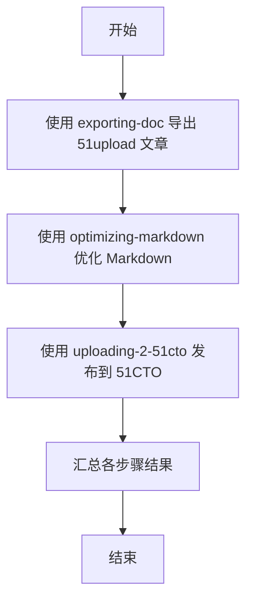
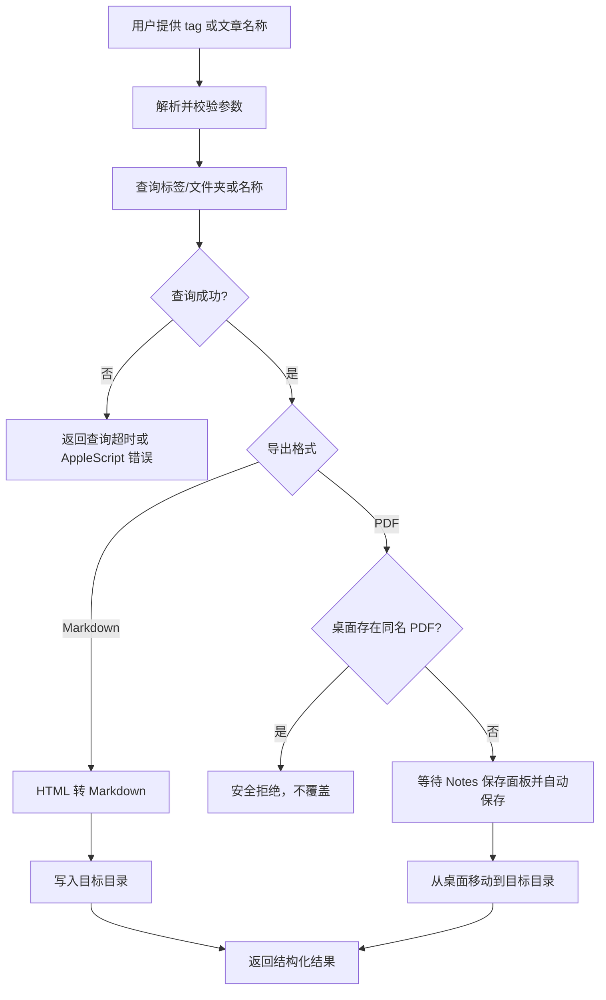
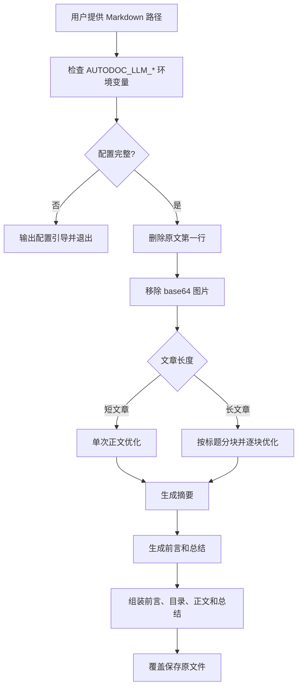
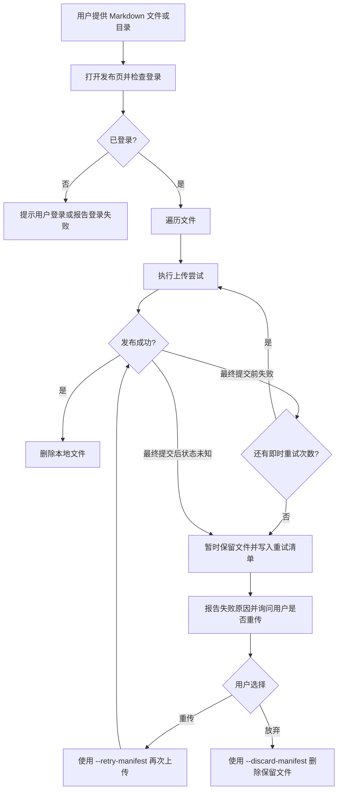

# AutoDocUpdater 流程图

本文档使用 Mermaid 源文本维护，便于随代码同步更新。旧的 PNG 流程图已移除。

## 主流程

## 备忘录导出

说明：主导出器不在导出阶段移除 base64 图片，base64 清理由优化阶段完成。

## Markdown 优化

## 51CTO 上传与重试

说明：

- 默认即时重试 1 次，仅用于最终提交前的可恢复失败。
- 最终提交后状态未知时不会自动重试，避免重复发布。
- 用户未确认前保留文件。
